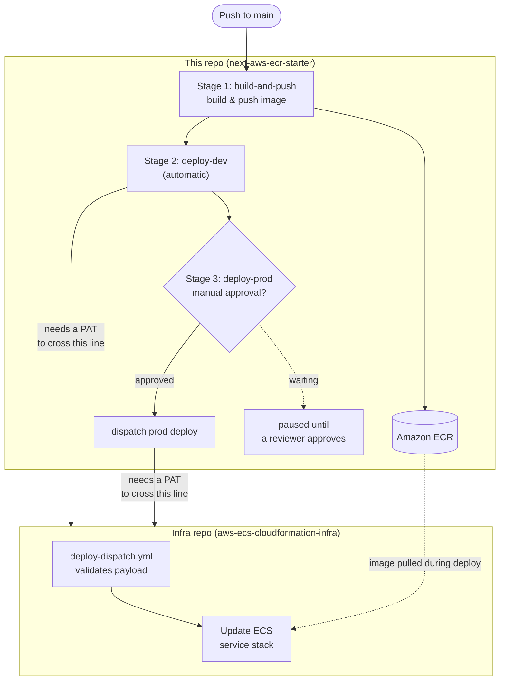
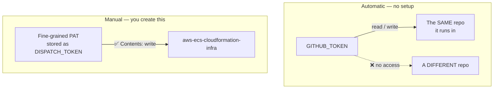
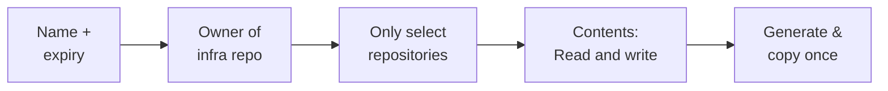
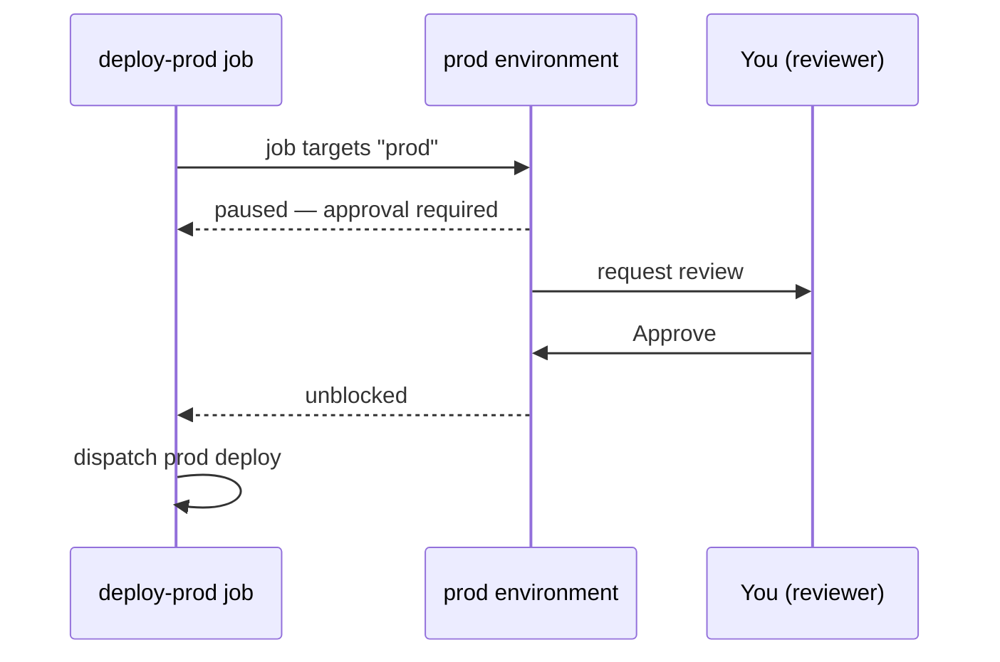

# Prerequisites

This project's deploy pipeline runs in three stages when you push to `main`:

1. **build-and-push** — builds a Docker image of the Next.js app and pushes it
   to **Amazon ECR**.
2. **deploy-dev** — automatically tells a **separate infrastructure repository**
   to roll that image out to the **dev** environment on Amazon ECS.
3. **deploy-prod** — waits for dev to succeed **and** for you to manually
   approve, then rolls the same image out to **prod**.

Two of those stages reach into **another** repository to start its workflow, and
one of them pauses for your approval. Neither works out of the box: you need to
set up a **Personal Access Token (PAT)** and a **GitHub Environment** first. This
document explains what those are, why they're needed, and how to create them — no
prior experience assumed.

---

## The big picture



Two separate mechanisms make this work, and this document sets up both:

- The **PAT** lets the deploy stages reach *across* into the infra repo (the
  "needs a PAT to cross this line" arrows).
- The **GitHub Environment** with a required reviewer is what *pauses* the prod
  stage until you approve it (the gate diamond).

---

## Part A — The PAT (cross-repo access)

### Why the built-in token isn't enough

Every GitHub Actions run automatically gets a temporary token called
`GITHUB_TOKEN`. It's convenient, but it is **scoped to the repository it runs
in**. It can read and write that repo, trigger that repo's own workflows, and
nothing else.

Our deploy stages need to POST a `repository_dispatch` event to a *different*
repo (`aws-ecs-cloudformation-infra`). `GITHUB_TOKEN` has no permission there, so
GitHub would reject the request. We need a credential that *does* have
permission on the infra repo. That credential is a **fine-grained Personal
Access Token**.



### What is a "repository_dispatch"?

It's GitHub's way of letting an outside caller start a workflow by sending an
event with a name and a small JSON payload. The infra repo's workflow listens
for an event named `web-app-image-pushed` and reads two values from the payload:

- `environment` — either `dev` or `prod`
- `image_uri` — the exact ECR image to deploy

The `deploy-dev` stage sends `environment: dev`; the `deploy-prod` stage sends
`environment: prod`. Both send the same `image_uri` (the image built in stage 1),
so prod deploys the exact build that dev validated. The PAT is what authorizes
the send.

### Fine-grained PAT vs. classic PAT

GitHub offers two kinds of personal access token. Prefer the **fine-grained**
one:

| | Fine-grained PAT (recommended) | Classic PAT |
|---|---|---|
| Scope | Pick exact repos + exact permissions | Broad, all-or-nothing scopes |
| Blast radius if leaked | One repo, one permission | Often your whole account |
| Expiry | Required | Optional |

Fine-grained tokens follow the principle of **least privilege**: grant the
smallest access that gets the job done. For us that's *write access to one repo*.

### Step A1 — Create the token

> You must be able to grant access to `aws-ecs-cloudformation-infra`. If it lives
> in an organization, an org owner may need to approve the token.

1. On GitHub, go to your avatar → **Settings**.
2. In the left sidebar: **Developer settings** → **Personal access tokens** →
   **Fine-grained tokens**.
3. Click **Generate new token**.
4. Fill in:
   - **Token name:** something descriptive, e.g. `dispatch-to-infra-repo`.
   - **Expiration:** pick a date (e.g. 90 days). Shorter is safer; you'll rotate
     it — see below.
   - **Resource owner:** the user or organization that owns the infra repo.
5. Under **Repository access**, choose **Only select repositories** and select
   **`aws-ecs-cloudformation-infra`**. Do *not* grant access to all repos.
6. Under **Permissions → Repository permissions**, find **Contents** and set it
   to **Read and write**.
   - This is the permission that lets the token send a `repository_dispatch`
     event to the repo.
7. Click **Generate token**.
8. **Copy the token now.** GitHub shows it only once. If you lose it, you delete
   it and make a new one — you can't view it again.



### Step A2 — Store the token as a repository secret

Never paste a token into code, a workflow file, or a commit. Anyone who can read
the repo would then have it. Store it as an encrypted **GitHub Actions secret**
instead. The workflow reads it at run time and GitHub masks it in logs.

Store it in **this** repo (`next-aws-ecr-starter`), because this is where the
build workflow runs:

1. Go to this repo on GitHub → **Settings**.
2. **Secrets and variables** → **Actions**.
3. On the **Secrets** tab, click **New repository secret**.
4. **Name:** `DISPATCH_TOKEN` (the workflow references this exact name).
5. **Secret:** paste the token you copied.
6. Click **Add secret**.

Both deploy stages use it like this (already wired up in
`.github/workflows/deploy.yml`):

```yaml
env:
  GH_TOKEN: ${{ secrets.DISPATCH_TOKEN }}
```

#### Secrets vs. variables — don't mix them up

GitHub Actions has **secrets** (encrypted, masked in logs — for credentials) and
**variables** (plain text, visible — for non-sensitive config). This repo uses
both:

| Name | Kind | Holds |
|---|---|---|
| `DISPATCH_TOKEN` | Secret | The PAT for cross-repo dispatch |
| `AWS_ROLE_ARN` | Secret | IAM role assumed via OIDC |
| `AWS_REGION` | Variable | e.g. `ap-southeast-1` |
| `ECR_REPOSITORY` | Variable | e.g. `nextjs-app` |

A token is a credential, so it is always a **secret**.

---

## Part B — The prod approval gate (GitHub Environments)

The `deploy-prod` stage must not run on its own. It waits for two things:

1. **deploy-dev to succeed** — handled in the workflow with `needs: deploy-dev`.
   No setup required.
2. **Your manual approval** — handled by a **GitHub Environment** with a
   **required reviewer**. This part you configure in the repo UI; it cannot be
   expressed in the YAML alone.

A GitHub Environment is a named target (like `dev` or `prod`) that a job can
attach to. You can put protection rules on an environment, and "required
reviewers" is one of them: when a job targets that environment, GitHub pauses it
and waits for a named person to click **Approve** before it runs.



### Step B1 — Create the `prod` environment with a required reviewer

1. Go to this repo on GitHub → **Settings** → **Environments**.
2. Click **New environment**, name it exactly **`prod`**, and create it.
3. Open the `prod` environment and enable **Required reviewers**.
4. Add **yourself** (and anyone else allowed to approve prod). Save.

That's the whole gate. The workflow's `deploy-prod` job already declares
`environment: prod`, so this rule takes effect automatically.

### Step B2 — (Optional) Create the `dev` environment

The `deploy-dev` job declares `environment: dev`. You don't strictly need to
create it — GitHub creates an environment implicitly the first time a job
references it — but creating it explicitly lets you add dev-only protection rules
or variables later. Leave it **without** required reviewers so dev stays
automatic.

---

## Confirm it all works

1. Push a commit to `main` (or merge a PR).
2. Open **Actions** → **Build and Push to Amazon ECR** and watch the run:
   - **build-and-push** builds and pushes the image to ECR.
   - **deploy-dev** runs automatically and prints `Dispatch sent.`
   - **deploy-prod** appears as **Waiting** — pending your review.
3. In `aws-ecs-cloudformation-infra`, the **Deploy Web App Service (dispatch)**
   workflow should start for the **dev** environment.
4. Back on the run, click **Review deployments**, approve **prod**, and the
   `deploy-prod` stage dispatches the prod deploy.

### If it fails

| Symptom | Likely cause |
|---|---|
| `curl` step returns 404 or 403 | Token missing `Contents: write`, or no access to the infra repo |
| `Bad credentials` | `DISPATCH_TOKEN` secret unset, misnamed, or holds an expired token |
| Infra workflow never starts | `event_type` mismatch, or the token's org needs to approve the token |
| Infra run fails validation | `environment` wasn't `dev`/`prod`, or `image_uri` was empty |
| `deploy-prod` runs without asking | `prod` environment has no required reviewer, or the job isn't bound to it |
| `deploy-prod` never unblocks | No one with approval rights clicked **Review deployments → Approve** |

---

## Keeping the token healthy (rotation)

A fine-grained token expires on the date you set. Before it does — or any time
you suspect it leaked — **rotate** it:

1. Generate a new token (Step A1).
2. Update the `DISPATCH_TOKEN` secret with the new value (Step A2).
3. Delete the old token under **Developer settings → Fine-grained tokens**.

Rotating on a schedule limits how long a leaked token stays useful. Treat the
expiry date as a reminder, not a surprise.

---

## Summary checklist

**PAT (Part A)**

- [ ] Fine-grained PAT created, scoped to `aws-ecs-cloudformation-infra` only
- [ ] Permission **Contents: Read and write** granted
- [ ] Token copied (shown only once)
- [ ] Stored in **this** repo as a secret named **`DISPATCH_TOKEN`**
- [ ] (Org repos) token approved by an org owner if required

**Approval gate (Part B)**

- [ ] `prod` environment created in this repo
- [ ] Yourself added as a **required reviewer** on `prod`
- [ ] (Optional) `dev` environment created, left without reviewers

**End to end**

- [ ] Pushed to `main`; dev dispatched automatically and the infra workflow ran
- [ ] `deploy-prod` paused for approval, then dispatched after you approved
- [ ] Expiry/rotation reminder noted
